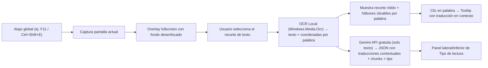

# 02 — Arquitectura y Plan de Desarrollo

## 1. Flujo de usuario (UX)



### Detalle clave del diseño: ¿Por qué una sola llamada a Gemini por captura?
En lugar de hacer una llamada a la API cada vez que tocás una palabra (lo cual sería lento y gastaría cuota diaria), hacemos **1 sola llamada liviana de texto** apenas termina el OCR local:
1. Le enviamos el texto extraído por OCR a Gemini (modelo Flash / Flash-Lite gratuito).
2. Le pedimos una respuesta en **JSON estructurado** con:
   - `word_map`: traducción contextual breve de cada palabra relevante de la frase (para que al tocar cualquier palabra la respuesta sea **instantánea, 0 ms**).
   - `chunks`: lista de *phrasal verbs*, modismos o frases de manual encontradas en el texto + cómo interpretarlas.
   - `grammar_tips`: máximo 2–3 tips ultra concisos sobre estructuras clave para leer bien la frase.

> **Ventaja enorme:** Con 1 sola request de ~150–300 tokens por captura, podés hacer cientos de capturas por día dentro del **tier gratuito de Google AI Studio** y, una vez cargado (en ~1 segundo), tocar 10 palabras distintas no gasta cuota adicional ni tiene latencia.

---

## 2. Arquitectura técnica

### Componentes principales
1. **Hotkey Listener (`pynput` o Win32 `RegisterHotKey`):**
   - Escucha en segundo plano (con ícono discreto en la bandeja del sistema / *system tray*).
   - *Nota sobre `F11`:* Como `F11` se usa en navegadores y juegos para pantalla completa, vamos a hacerlo configurable (ej. `F11` si querés reemplazarlo, o `Alt+F11` / `F9` / `Ctrl+Shift+Space` para evitar choques).
2. **Captura y Overlay con Blur (`mss` + `Pillow` + `PySide6`):**
   - Toma una captura instantánea del monitor activo.
   - Genera una versión desenfocada (*Gaussian Blur* + oscurecimiento sutil) para el fondo.
   - Abre una ventana fullscreen sin bordes (*always-on-top*).
   - El usuario arrastra un rectángulo sobre el texto que quiere leer: dentro del rectángulo se ve la imagen **nítida** original; afuera queda **desenfocado**.
3. **OCR Local nativo de Windows (`Windows.Media.Ocr`):**
   - Costo **$0**, corre 100% local en milisegundos.
   - Devuelve cada línea y **cada palabra con su `BoundingRect` (`x, y, width, height`)**.
   - Con esas coordenadas dibujamos zonas interactivas exactas sobre cada palabra de la captura.
4. **Motor lingüístico (`google-genai` SDK):**
   - Usa la API gratuita de Google AI Studio (`GEMINI_API_KEY`).
   - Prompt diseñado con los principios de `01-fundamentos-aprendizaje.md` (prohibida traducción completa, foco en *chunks*, polisemia y *noticing*).
   - Salida en JSON estructurado (*Structured Outputs*) para que nunca se rompa el parseo.

---

## 3. Estructura del proyecto

```text
english-lens/
├── README.md
├── docs/
│   ├── 01-fundamentos-aprendizaje.md
│   ├── 02-arquitectura-y-plan.md
│   └── BITACORA.md
├── src/
│   ├── main.py              # Punto de entrada + system tray + hotkey
│   ├── capture.py           # Captura de pantalla y generación de fondo blur
│   ├── ocr_windows.py       # Wrapper de Windows.Media.Ocr (texto + bounding boxes)
│   ├── ai_tutor.py          # Cliente google-genai + prompt pedagógico + JSON schema
│   └── overlay_ui.py        # Ventana PySide6 (recorte, palabras clicables, tooltips, panel de tips)
├── requirements.txt
└── .env.example             # GEMINI_API_KEY=tu_api_key
```

---

## 4. Plan de implementación por fases

- **Fase 1 — Esqueleto + Captura + Blur:**
  Crear entorno virtual en Python 3.14, abrir el overlay fullscreen desenfocado con hotkey y permitir recortar la región nítida (cerrando con `Esc`).
- **Fase 2 — OCR Local con coordenadas por palabra:**
  Conectar `Windows.Media.Ocr` al recorte y dibujar cajitas/resaltado suave al pasar el mouse por cada palabra detectada.
- **Fase 3 — Conexión con Gemini API gratuita + Tooltips + Panel de Tips:**
  Integrar `google-genai`, recibir traducciones contextuales + *chunks* + tips en JSON, mostrar tooltip al hacer clic en cualquier palabra y desplegar la tarjeta flotante de tips de lectura.
- **Fase 4 — Ajustes personales y documentación final:**
  Selector de nivel (B1/B2/C1), personalización del atajo y mejoras visuales según uso real.
